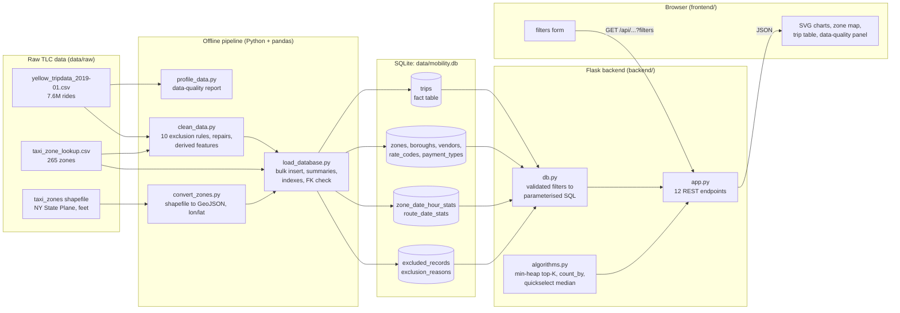

# NYC Urban Mobility Data Explorer

An interactive dashboard for exploring every yellow taxi ride in New York City
during January 2019. Filter by borough, zone, time of day, fare range, and more.
The whole page updates instantly.

**Video walkthrough:** <!-- ADD YOUR VIDEO LINK HERE before submitting -->

**Architecture diagram:** see [Architecture](#architecture) below.

**Scrum board:** <!-- ADD YOUR SCRUM BOARD LINK HERE -->

---

## What the project does

| Layer | Technology | Role |
|-------|-----------|------|
| Pipeline | Python + pandas | Cleans raw data, engineers features, builds the DB |
| Database | SQLite | Star-schema with pre-aggregated summary tables |
| Backend | Flask (Python) | REST API serving filtered aggregates and trip records |
| Frontend | HTML + CSS + JS (no frameworks) | Interactive dashboard with SVG charts and a zone map |

---

## Architecture



**Request path:** the browser sends its filters as URL parameters. `db.py`
validates them and builds a parameterised `WHERE` clause. `app.py` reads from
the small pre-aggregated summary tables when the filters allow it, and falls
back to the full `trips` table when they don't (distance, fare, payment and
airport filters). Ranking and medians are computed by the hand-written code in
`algorithms.py`, not by SQL `ORDER BY`.

---

## Quick start

### 1. Clone and install

Requires **Python 3.10 or newer** (tested on 3.14 with pandas 3.0).

```bash
git clone https://github.com/k-kuol/Summative-Demo---Urban-Mobility-Data-Explorer.git
cd Summative-Demo---Urban-Mobility-Data-Explorer
python -m venv venv
```

Activate the virtual environment:

```bash
# Windows (PowerShell)
venv\Scripts\activate

# macOS / Linux
source venv/bin/activate
```

Then install the dependencies:

```bash
pip install -r requirements.txt
```

### 2. Download the raw data

Place these three items inside `data/raw/`:

| File | Source |
|------|--------|
| `yellow_tripdata_2019-01.parquet` **or** `.csv` | [NYC TLC Trip Records](https://www.nyc.gov/site/tlc/about/tlc-trip-record-data.page) — January 2019 Yellow Taxi. Either format works; no conversion needed. If both are present, the parquet file is used. |
| `taxi_zone_lookup.csv` | Same TLC page → Taxi Zone Lookup Table |
| `taxi_zones/` (folder with `.shp`, `.dbf`, `.prj`, …) | Same TLC page → Taxi Zone Shapefile |

Your `data/raw/` folder should look like:

```
data/raw/
├── yellow_tripdata_2019-01.parquet   (or .csv)
├── taxi_zone_lookup.csv
└── taxi_zones/
    ├── taxi_zones.shp
    ├── taxi_zones.dbf
    └── taxi_zones.prj
```

> **Note on `taxi_zones.zip`:** extract it into `data/raw/taxi_zones/`.
> Depending on where you downloaded it, the zip either holds the shapefile
> parts directly or wraps them in its own `taxi_zones/` folder; both layouts
> work, because `convert_zones.py` looks in either place.
>
> ```bash
> mkdir -p data/raw/taxi_zones
> unzip taxi_zones.zip -d data/raw/taxi_zones          # macOS / Linux
> # Windows PowerShell:
> # Expand-Archive taxi_zones.zip -DestinationPath data\raw\taxi_zones
> ```

### 3. (Optional) Make a small sample for testing

If you want to test quickly without loading 7.5 million rows:

```bash
python pipeline/make_sample.py data/raw/yellow_tripdata_2019-01.csv 0.05
# Creates data/raw/yellow_tripdata_sample.csv (≈5% of rides)
# make_sample.py reads CSV only. Then pass the sample to the pipeline with --input:
python pipeline/clean_data.py --input data/raw/yellow_tripdata_sample.csv
```

### 4. Run the data pipeline

```bash
# Step 1: profile the raw data (optional but informative)
python pipeline/profile_data.py

# Step 2: clean, normalize, and engineer features
python pipeline/clean_data.py

# Step 3: convert the shapefile to GeoJSON (standard library only, no GDAL needed)
python pipeline/convert_zones.py

# Step 4: build the SQLite database
python database/load_database.py           # full dataset (~5–8 min, ~2.8 GB)
# OR, for a faster build on a smaller machine:
python database/load_database.py --sample 0.1   # 10% sample, much faster
```

### 5. Start the backend

```bash
python backend/app.py
# Dashboard is now at http://127.0.0.1:5000
```

Open your browser at **http://127.0.0.1:5000** — the Flask server also serves
the frontend, so no separate web server is needed.

---

## Environment variables

| Variable | Default | Description |
|----------|---------|-------------|
| `MOBILITY_DB` | `data/mobility.db` | Path to the SQLite database |
| `HOST` | `127.0.0.1` | Bind address (`0.0.0.0` to expose on the network) |
| `PORT` | `5000` | Port number |
| `FLASK_DEBUG` | _(unset)_ | Set to `1` to enable Flask debug mode |

Example:

```bash
# macOS / Linux
MOBILITY_DB=/data/mobility.db PORT=8080 python backend/app.py
```

```powershell
# Windows PowerShell
$env:MOBILITY_DB = "C:\data\mobility.db"; $env:PORT = "8080"; python backend/app.py
```

---

## Troubleshooting

| Problem | Fix |
|---------|-----|
| `Database not found at ...` | Run the four pipeline steps in section 4 first. |
| `convert_zones.py` cannot find `taxi_zones.shp` | Extract the zip **into** `data/raw/taxi_zones/` (see the note in section 2). |
| `ModuleNotFoundError: No module named 'pandas'` | Activate the virtual environment, then run `pip install -r requirements.txt`. |
| Charts stay blank | Open DevTools (F12) → Console. Make sure `python backend/app.py` is running and you opened `http://127.0.0.1:5000`, not `index.html` directly. |
| Pipeline runs out of memory | Use the sample workflow at the bottom of this file. |

---

## Project structure

```
MyTaxiApp/
├── backend/
│   ├── app.py              Flask API + static file server
│   ├── db.py               DB connection, filter parsing, WHERE-clause builder
│   └── algorithms.py       Hand-written MinHeap, top-K, count_by, quickselect
├── database/
│   ├── schema.sql          Star schema (trips fact + dimension + summary tables)
│   ├── indexes.sql         Performance indexes (applied after bulk load)
│   └── load_database.py    Builds data/mobility.db from the cleaned CSVs
├── pipeline/
│   ├── profile_data.py     Step 1: data quality report on the raw CSV
│   ├── clean_data.py       Step 2: exclusion rules, repairs, feature engineering
│   ├── convert_zones.py    Step 3: shapefile → GeoJSON (pure stdlib, no GDAL)
│   ├── trips_io.py         Shared loader: .parquet or .csv, --input option
│   └── make_sample.py      Optional: random sample for fast local testing
├── frontend/
│   ├── index.html          Single-page dashboard
│   ├── css/style.css       All styles (light + dark mode)
│   └── js/
│       ├── main.js         Wires filters → API → charts
│       ├── api.js          fetch wrapper + number formatters
│       ├── charts.js       Hand-drawn SVG line, bar, heatmap, hbars
│       └── map.js          SVG zone map with zoom/pan and quantile colouring
├── data/
│   ├── raw/                Raw input files (git-ignored)
│   └── processed/          Cleaned CSVs, GeoJSON, cleaning_summary.json
├── docs/
│   └── screenshots/        Test screenshots for the report
├── requirements.txt
└── README.md
```

---

## API endpoints

All endpoints accept the same optional filter parameters:

| Parameter | Type | Description |
|-----------|------|-------------|
| `start_date` / `end_date` | `YYYY-MM-DD` | Inclusive date range |
| `borough_id` | integer | Filter by pickup borough |
| `zone_id` | integer | Filter by pickup zone (1–265) |
| `dow` | 0–6 | Day of week (0 = Monday) |
| `hour_min` / `hour_max` | 0–23 | Hour range |
| `min_distance` / `max_distance` | float (miles) | Trip distance range |
| `min_fare` / `max_fare` | float ($) | Fare range |
| `payment_type_id` | integer | 1 = card, 2 = cash, … |
| `airport_only` | `1` | Only trips to/from JFK, LGA, EWR |

| Endpoint | Description |
|----------|-------------|
| `GET /api/health` | Liveness check + total trip count |
| `GET /api/meta` | Boroughs, zones, payment types, date range |
| `GET /api/summary` | KPI headline numbers |
| `GET /api/by-hour` | Trips and speed by hour of day |
| `GET /api/by-day` | Daily totals (time series) |
| `GET /api/heatmap` | Weekday × hour grid |
| `GET /api/zone-stats` | Per-zone pickup counts and averages |
| `GET /api/top-routes?k=10` | Top-K busiest pickup → dropoff pairs |
| `GET /api/zones/<id>` | Zone detail: top destinations, median fare |
| `GET /api/trips` | Paginated, sortable trip list |
| `GET /api/data-quality` | Exclusion log and cleaning summary |
| `GET /api/zones/geojson` | GeoJSON zone shapes for the map |

---

## Algorithms (hand-written, no built-in sort/heap/Counter)

See `backend/algorithms.py` for full implementation and self-tests.

| Algorithm | Where used | Complexity |
|-----------|-----------|------------|
| **MinHeap + top_k** | Ranking the K busiest routes from thousands of zone pairs | O(n log k) time, O(k) space |
| **count_by** | Counting dropoff destinations for a zone detail panel | O(n) time, O(distinct) space |
| **Quickselect (3-way)** | Median fare per zone without sorting all fares | O(n) average time |

Run the self-tests:

```bash
python backend/algorithms.py
# All algorithm self-tests passed.
```

---

## Running on a sample (for quick runs or low-memory machines)

```bash
# 1. Make a 5% sample
python pipeline/make_sample.py data/raw/yellow_tripdata_2019-01.csv 0.05

# 2. Clean the sample instead of the full file
python pipeline/clean_data.py --input data/raw/yellow_tripdata_sample.csv

# 3. Run the rest of the pipeline as normal
python pipeline/convert_zones.py
python database/load_database.py

# 4. Start the server
python backend/app.py
```

---

## Deployment (Render, free tier)

The full database is ~2.8 GB, too large for free hosting, so the repo ships a
**1% random-sample database** at `deploy/mobility_sample.db` (~45 MB). The
dashboard shows a notice when it runs on a sample, because ride counts shrink
with the sample while averages, speeds and patterns do not.

1. Push the repo to GitHub (https://github.com/k-kuol/Summative-Demo---Urban-Mobility-Data-Explorer).
2. On [render.com](https://render.com), choose **New → Blueprint** and select
   the repo. Render reads `render.yaml` and creates the web service.
3. Wait for the build, then open the URL Render gives you.

The server only needs Flask (plus gunicorn on Render); pandas is used by the
offline pipeline, not at runtime.

To rebuild the sample database after changing the pipeline:

```bash
python database/load_database.py --sample 0.01 --out deploy/mobility_sample.db
```

**Live site:** <!-- ADD YOUR RENDER URL HERE after deploying -->
